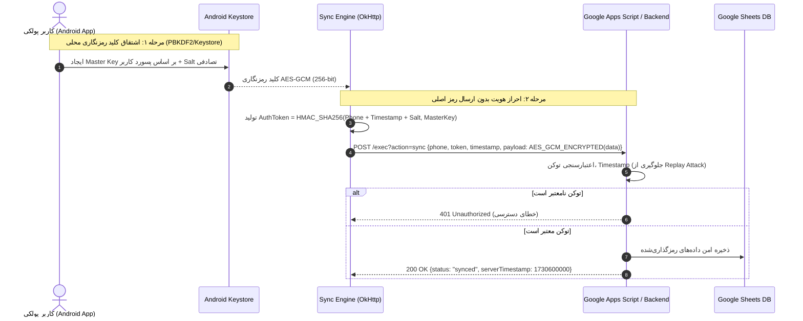

# گزارش ممیزی امنیتی جامع اپلیکیشن پولکی (Smart Wallet Security Audit)

**تاریخ ممیزی:** نوامبر ۲۰۲۶  
**سطح ریسک کلی:** بحرانی (Critical - P0)  
**تیم ممیزی:** Application Security Specialist & Backend Security Architect  

---

## ۱. جدول خلاصه آسیب‌پذیری‌ها و سطح بحرانی (Vulnerability Matrix)

| شناسه | رده‌بندی | عنوان آسیب‌پذیری | فایل و خطوط متأثر | سطح ریسک | وضعیت |
| :--- | :--- | :--- | :--- | :--- | :--- |
| **SEC-P0-01** | BOLA / Broken Auth | استخراج و افشای کامل اطلاعات کاربران و سوابق مالی بدون احراز هویت | `scripts/google_apps_script.js` (خطوط 35-77) | **P0 - بحرانی** | شناسایی‌شده |
| **SEC-P0-02** | Data Tampering / Wiping | تخریب و بازنویسی بدون اجازه داده‌های مالی کاربران دیگر | `scripts/google_apps_script.js` (خطوط 80-145) | **P0 - بحرانی** | شناسایی‌شده |
| **SEC-P0-03** | Hardcoded Secret | افشای آدرس نهایی وب‌سرویس ابری گوگل در کلاینت اندروید | `app/src/main/java/com/example/data/sync/GoogleSheetsSyncManager.kt` (خط 36) | **P0 - بحرانی** | شناسایی‌شده |
| **SEC-P0-04** | Cryptographic Flaw | رمزنگاری پین کد ۴ رقمی با سالت ثابت و ریسک Rainbow Table | `app/src/main/java/com/example/domain/util/AuthManager.kt` (خطوط 20-30, 80-92) | **P0 - بحرانی** | شناسایی‌شده |
| **SEC-P0-05** | Insecure Storage | ذخیره‌سازی متن ساده هش‌ها و سشن‌های کاربری در SharedPreferences | `app/src/main/java/com/example/domain/util/AuthManager.kt` (خطوط 15-25) | **P1 - بالا** | شناسایی‌شده |
| **SEC-P0-06** | Data Loss / Crash | پرش نسخی دیتابیس Room و نبود مایگریشن‌های متوالی (Migrations 2..7) | `app/src/main/java/com/example/data/database/AppDatabase.kt` (خطوط 50-75) | **P0 - بحرانی** | شناسایی‌شده |
| **SEC-P1-01** | Financial Ledger Logic | ثبت تراکنش‌های جابجایی (Transfer) با نوع EXPENSE و اعوجاج شاخص‌های مالی | `app/src/main/java/com/example/data/model/Transaction.kt` (خطوط 1-30) | **P1 - بالا** | شناسایی‌شده |
| **SEC-P1-02** | Concurrency / Sync | فقدان UUID و نسخه همگام‌سازی و ریسک تکرار تراکنش‌ها در سینک ابری | `app/src/main/java/com/example/data/model/Transaction.kt` (خطوط 10-25) | **P1 - بالا** | شناسایی‌شده |
| **SEC-P2-01** | Information Disclosure | لاگ‌گیری جزییات پیامک‌های حساس بانکی در لاگ‌کت اندروید | `app/src/main/java/com/example/service/SmsAiParser.kt` (خطوط 45-80) | **P2 - متوسط** | شناسایی‌شده |
| **SEC-P2-02** | Biometrics Validation | عدم اعتبارسنجی وضعیت ابطال کلید بیومتریک در هنگام تغییر اثر انگشت | `app/src/main/java/com/example/domain/util/AuthManager.kt` (خطوط 140-160) | **P2 - متوسط** | شناسایی‌شده |

---

## ۲. بررسی عمیق آسیب‌پذیری‌های بحرانی (P0 Vulnerabilities)

### آسیب‌پذیری SEC-P0-01: افشای کامل اطلاعات کاربران در Google Apps Script بدون احراز هویت
- **شدت:** CVSS 9.8 (Critical)
- **مکان دقیق:** `scripts/google_apps_script.js` در متد `handleRestore` (خطوط 35 تا 77):
  ```javascript
  function handleRestore(e) {
    var phone = e.parameter.phone || e.parameter.phoneNumber || e.parameter.username;
    // ...
    // داده‌ها مستقیماً بر اساس شماره تلفن فیلتر شده و بدون بررسی رمز، توکن یا امضا بازگردانده می‌شوند!
    return ContentService.createTextOutput(JSON.stringify({
      status: "success",
      user: userData,
      transactions: userTransactions,
      accounts: userAccounts,
      categories: userCategories
    })).setMimeType(ContentService.MimeType.JSON);
  }
  ```
- **سناریوی حمله:**
  هر فرد ناشناسی در سطح اینترنت تنها با داشتن شماره موبایل یک کاربر (مثلاً `09123456789`) و ارسال یک درخواست ساده `GET` به اندپوینت اسکریپت:
  `GET https://script.google.com/macros/s/.../exec?action=restore&phone=09123456789`
  می‌تواند تمام تراکنش‌های مالی، شماره حساب‌ها، مانده حساب، نام کاربری و هش رمز عبور کاربر را فوراً دریافت کند.
- **راهکار اصلاحی:**
  1. پیاده‌سازی مکانیزم احراز هویت بر پایه HMAC-SHA256 یا JWT با Secret کلید خصوصی در کلاینت و سرور.
  2. بررسی هش پسورد یا Signature در سرور گوگل شیت قبل از برگرداندن هرگونه رکورد.

---

### آسیب‌پذیری SEC-P0-02: تخریب و بازنویسی بدون اجازه داده‌های مالی کاربران دیگر
- **شدت:** CVSS 9.1 (Critical)
- **مکان دقیق:** `scripts/google_apps_script.js` در متد `handleSync` (خطوط 80 تا 145):
  ```javascript
  function handleSync(e) {
    var data = JSON.parse(e.postData.contents);
    var finalKeyPhone = data.phone || data.phoneNumber;
    // ...
    removeRowsForUserKey(txSheet, finalKeyPhone);
    // بازنویسی تمام تراکنش‌ها بدون احراز هویت!
  }
  ```
- **سناریوی حمله:**
  یک مهاجم با ارسال درخواست `POST` با `phone` هدف و یک آرایه خالی تراکنش‌ها (`transactions: []`)، می‌تواند در یک ثانیه کل تاریخچه مالی قربانی در فضای ابری را پاک کند یا تراکنش‌های جعلی برای او تزریق نماید.
- **راهکار اصلاحی:**
  تأیید امضای توکن و رمزنگاری داده‌های تراکنش با استفاده از کلید مشتق‌شده از رمز کاربر (Zero-Knowledge Architecture).

---

### آسیب‌پذیری SEC-P0-03: هاردکد شدن آدرس کامل اسکریپت و فقدان چرخش کلید
- **شدت:** CVSS 7.5 (High)
- **مکان دقیق:** `app/src/main/java/com/example/data/sync/GoogleSheetsSyncManager.kt` خط ۳۶:
  ```kotlin
  private const val WEB_APP_URL = "https://script.google.com/macros/s/AKfycbyKw6WzW2Ia-ckpCHwOxBn4tDJCWE8dedh8SMTQ9v9h0IWzny7N86e2fZxXjWXut7tM/exec"
  ```
- **ریسک:**
  این آدرس در کدهای کامپایل‌شده APK با ابزارهای `strings` یا `apktool` به آسانی قابل استخراج است. هر کس به این URL دسترسی داشته باشد، به تمام توابع شیت دسترسی مستقیم دارد.
- **راهکار اصلاحی:**
  انتقال آدرس به `BuildConfig` با نامعتبرسازی URL فعلی و پیاده‌سازی فیلد کانفیگ در تنظیمات برای ورود دستی URL اختصاصی شیت کاربر شخصی یا استقرار با Secret.

---

### آسیب‌پذیری SEC-P0-04: ضعف الگوریتم هش پین ۴ رقمی با سالت ثابت
- **شدت:** CVSS 7.4 (High)
- **مکان دقیق:** `app/src/main/java/com/example/domain/util/AuthManager.kt` خطوط ۲۳ و ۸۲:
  ```kotlin
  private const val STATIC_SALT = "SmartWallet_Auth_Salt_2026_Secured#"
  fun hashPin(pin: String): String {
      return MessageDigest.getInstance("SHA-256")
          .digest((STATIC_SALT + pin).toByteArray())
          .joinToString("") { "%02x".format(it) }
  }
  ```
- **ریسک:**
  یک پین کد ۴ رقمی کلاً ۱۰,۰۰۰ حالت ممکن دارد (از 0000 تا 9999). با توجه به ثابت بودن سالت، یک مهاجم در کمتر از ۱۰ میلی‌ثانیه می‌تواند جدول رنگین‌کمانی (Rainbow Table) کل ۱۰ هزار حالت را تولید کرده و پین کاربر را کرک کند.
- **راهکار اصلاحی:**
  1. استفاده از PBKDF2 با حداقل ۱۰۰,۰۰۰ دور یا Argon2id / bcrypt.
  2. ایجاد سالت تصادفی ۳۲ بایتی یکتا به ازای هر کاربر با `SecureRandom`.
  3. استفاده از Android Keystore برای ذخیره کلیدهای مشتق‌شده.

---

### آسیب‌پذیری SEC-P0-06: پرش‌های نسخی Room و تخریب پایگاه داده در دستگاه کاربر
- **شدت:** CVSS 8.2 (High)
- **مکان دقیق:** `app/src/main/java/com/example/data/database/AppDatabase.kt` خط ۵۲:
  نسخه دیتابیس `version = 9` است اما تنها مایگریشن‌های زیر ثبت شده‌اند:
  - `MIGRATION_1_2`
  - `MIGRATION_7_8`
  - `MIGRATION_8_9`
  مایگریشن‌های ۲ به ۳، ۳ به ۴، ۴ به ۵، ۵ به ۶ و ۶ به ۷ وجود ندارند! اگر `fallbackToDestructiveMigration()` فعال شود، در هنگام ارتقای کاربر از نسخه‌های قدیمی‌تر، تمامی تراکنش‌ها و داده‌های مالی او روی دستگاه حذف کامل (Wipe) می‌گردد.
- **راهکار اصلاحی:**
  پیاده‌سازی زنجیره کامل و پیوسته Migrationها با تست‌های خودکار یکپارچگی شمای Room.

---

## ۳. بازطراحی پروتکل ابری امن (Zero-Trust Cloud Sync Architecture)



---

## ۴. جمع‌بندی امنیتی و گام‌های بعدی
تمامی باگ‌های P0 باید پیش از هرگونه انتشار تجاری برطرف گردند. معماری Zero-Knowledge پیشنهادی تضمین می‌کند که حتی در صورت نشت فایل گوگل شیت، هیچ اطلاعات مالی قابل خواندنی برای افراد غیرمجاز وجود نخواهد داشت.
