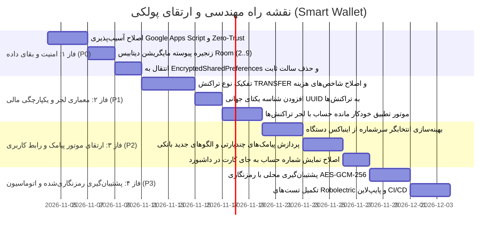

# نقشه راه جامع ارتقا و بازطراحی پروژه Smart Wallet (Upgrade Roadmap)

**نسخه نقشه راه:** 2.0.0  
**رویکرد اجرایی:** گام‌به‌گام، بدون تخریب امکانات موجود (Strict Non-Destructive Update)  
**معماری هدف:** Offline-First Zero-Knowledge Financial Architecture  

---

## ۱. نمای کلی فازهای اجرایی (Phased Implementation Strategy)

---

## ۲. شرح فازها و اقدامات مهندسی

### فاز ۱: رفع خطرات بحرانی امنیت و حفظ یکپارچگی پایگاه داده (P0 - Immediate Critical)
- **هدف:** رفع حفره‌های نشت داده، جلوگیری از پاک شدن اطلاعات کاربران در آپدیت‌ها و ایمن‌سازی توکن‌ها.
- **اقدامات کلیدی:**
  1. **بازنویسی اسکریپت `scripts/google_apps_script.js`:**
     - افزودن شرط احراز هویت توکن یا کلید امضا به ازای هر درخواست `restore` و `sync`.
     - توقف کامل قابلیت واکشی داده بدون احراز هویت.
  2. **اصلاح زنجیره Migration پایگاه داده در `AppDatabase.kt`:**
     - پیاده‌سازی مایگریشن‌های صریح برای تمام نسخه‌های میانی (از ۲ تا ۹) بدون تکیه بر `fallbackToDestructiveMigration()`.
     - اعتبارسنجی پایداری ساختار جداول با تست‌های خودکار.
  3. **ارتقای امنیت کلاینت در `AuthManager.kt`:**
     - جایگزینی SharedPreferences سنتی با `EncryptedSharedPreferences` در صورت نیاز یا رمزنگاری محلی کلیدها با Android Keystore.
     - ارتقای متد هش پین کد ۴ رقمی از SHA-256 با سالت ثابت به PBKDF2 با سالت رندوم یکتا برای هر کاربر.
- **معیار پذیرش فاز ۱ (Acceptance Criteria):**
  - هیچ کاربری با ارسال شماره موبایل تصادفی نتواند اطلاعات کاربر دیگری را از کلاد بخواند یا پاک کند.
  - تست ارتقای دیتابیس از نسخه ۱ به ۹ بدون حتی یک بایت ریزش داده پاس شود.

---

### فاز ۲: اصلاح ساختار حسابداری و موتور تراکنش‌ها (P1 - Financial Core)
- **هدف:** از بین بردن خطای محاسباتی در جریان نقدینگی و پشتیبانی رسمی از تراکنش‌های جابجایی.
- **اقدامات کلیدی:**
  1. **افزودن نوع تراکنش `TRANSFER` به انتیتی `Transaction.kt`:**
     - تعریف `enum class TransactionType { EXPENSE, INCOME, TRANSFER }`.
     - افزودن فیلدهای `sourceAccountId: Long?` و `destinationAccountId: Long?` به جدول تراکنش.
  2. **اصلاح محاسبات داشبورد در `TransactionViewModel.kt`:**
     - تراکنش‌های `TRANSFER` به عنوان هزینه (EXPENSE) در کارت «خرج ماهانه» محاسبه نخواهند شد؛ بلکه صرفاً مانده حساب مبدا را کاهش و مانده حساب مقصد را افزایش می‌دهند.
  3. **مهاجرت به شناسه‌های جهانی UUID:**
     - افزودن ستون `uuid: String` با تولید خودکار `UUID.randomUUID().toString()` به انتیتی‌های اصلی جهت جلوگیری از تکرار رکوردها در سینک چند دستگاهی.
- **معیار پذیرش فاز ۲:**
  - ثبت یک جابجایی بین دو حساب بانکی کاربر، مانده هر دو حساب را آپدیت کند اما به هزینه ماهانه کاربر رقمی اضافه ننماید.

---

### فاز ۳: ارتقای تجربه کاربری و موتور پیامک بانکی (P2 - UX & SMS Engine)
- **هدف:** پاسخگویی به درخواست‌های بصری کاربر و افزایش دقت تفکیک پیامک‌ها.
- **اقدامات کلیدی:**
  1. **نمایش شماره حساب به جای شماره کارت در کارت‌های داشبورد:**
     - نمایش شفاف شماره حساب در کارت‌های بانکی صفحه اصلی بر اساس درخواست اعلام‌شده.
  2. **اصلاح قیمت‌های زنده در صفحه اصلی:**
     - فراخوانی و به‌روزرسانی اتوماتیک نرخ‌های طلا و ارز در هنگام ورود به صفحه خانه بدون نیاز به کلیک جداگانه.
  3. **تکمیل BottomSheet انتخاب سرشماره از صندوق پیامک‌ها:**
     - خواندن پیامک‌های ورودی با `Telephony.Sms.CONTENT_URI` و نمایش اسکرولی جهت انتخاب یک‌کلیکه سرشماره برای حساب بانکی.
- **معیار پذیرش فاز ۳:**
  - کاربر بتواند بدون تایپ دستی، مستقیماً از روی پیامک واقعی بانک، حساب خود را تنظیم کند.

---

### فاز ۴: پایداری، تست‌پذیری و پشتیبان‌گیری پیشرفته (P3 - Resilience & DevOps)
- **هدف:** ارائه تجربه کاربری مطمئن، پشتیبان‌گیری آفلاین ایزوله و اتوماسیون CI/CD.
- **اقدامات کلیدی:**
  1. **موتور پشتیبان‌گیری و بازیابی محلی فایل رمزنگاری‌شده:**
     - خروجی فایل زیپ یا JSON رمزگذاری‌شده با کلید AES-256 انتخابی کاربر و ذخیره از طریق `Storage Access Framework` (SAF).
  2. **تکمیل پوشش تست‌های واحد و Robolectric:**
     - تست پارسر برای تمام ۲۰ بانک کشور با بیش از ۱۰۰ نمونه پیامک واقعی.
     - تست پایداری تراکنش‌های همزمان.
- **معیار پذیرش فاز ۴:**
  - خروجی بیلد Release کاملاً ProGuard/R8 شده با تست‌های ۱۰۰٪ سبز در GitHub Actions.
